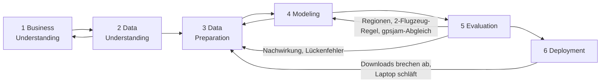

# Vorgehen nach CRISP-DM

Dieses Dokument zeigt, wie das Projekt **GPS-Störradar Europa** entlang des
Vorgehensmodells CRISP-DM (Cross-Industry Standard Process for Data Mining)
durchgeführt wurde. Zu jeder Phase stehen die Aufgaben, die getroffenen
Entscheidungen mit Begründung, die Ergebnisse und die Dateien, in denen sie
nachvollziehbar sind.

CRISP-DM ist kein Wasserfall. Die wichtigsten Erkenntnisse des Projekts
entstanden in Rücksprüngen von der Evaluation zurück in die Datenaufbereitung.
Diese Iterationen sind in [Abschnitt 7](#7-iterationen-im-überblick) gesammelt.

---

## 1 Business Understanding

**Ausgangslage.** GNSS-Störungen (Jamming) und Positionsfälschungen (Spoofing)
betreffen den Luftverkehr und die Schifffahrt in Teilen Europas. Ein öffentlich
nachvollziehbares Lagebild gibt es mit gpsjam.org bisher vor allem als fertige Karte; hier soll die ganze Verarbeitung offen und prüfbar sein.

**Projektziel.** Aus frei verfügbaren ADS-B-Daten bestimmen, *wo* und *wann* über
Europa GPS gestört wird, und das als animierte Karte zeigen.

**Fragestellungen**

| # | Frage | Beantwortet durch |
|---|---|---|
| F1 | Wo liegen die Störzonen? | Gestörte H3-Zellen und Zonen je Tag |
| F2 | Wie groß sind sie und wie stabil über die Zeit? | Gestörte Fläche je Region und Tag |
| F3 | Gibt es zeitliche Muster (Tagesgang, Aufflammen)? | Stundenprofil, robuster z-Score |
| F4 | Skaliert das Verfahren auf große Datenmengen? | Dask lokal, Spark-Job mit identischem Ergebnis |

**Stakeholder und Nutzen.** Flugsicherung und Airlines (Lagebild für die
Flugvorbereitung), Schifffahrt (dieselben Störsender), Öffentlichkeit und
Forschung (sicherheitspolitische Transparenz), Kurs (Nachweis von
Big-Data-Methoden).

**Erfolgskriterien**

| Kriterium | Messgröße |
|---|---|
| K1 Plausibilität | Störgebiete werden ohne Vorgabe gefunden und von einem zweiten, separat erhobenen Lagebild (gpsjam.org) gestützt |
| K2 Keine Artefakte | Keine Störzonen entlang einzelner Flugrouten oder in Westeuropa |
| K3 Statistische Absicherung | Jede gestörte Zelle ist gegen Zufall getestet; die Ergebnisse sind gegen Änderungen der Schwellen geprüft |
| K4 Skalierbarkeit | Verarbeitung von mindestens einer Woche (> 500 Mio. Meldungen); Ergebnis unabhängig von der Engine |
| K5 Kommunikation | Animierte Karte, die ohne Server läuft |

**Rahmenbedingungen.** Nur offene Daten, Rechnen auf einem Laptop (10 Kerne,
16 GB RAM), Code muss auf einen Cluster übertragbar sein.

**Projektplan.** Die sechs Phasen in der Reihenfolge von CRISP-DM, mit
Rücksprüngen nach jeder Evaluation (siehe Abschnitt 7).

---

## 2 Data Understanding

### 2.1 Datenquellen bewertet

| Quelle | Prüfung | Entscheidung |
|---|---|---|
| OpenSky Network (Trino) | Forschungszugang nur auf Antrag | Nicht genutzt (Zeitrahmen), als Alternative dokumentiert |
| airplanes.live API | Testabruf: HTTP 403 | Verworfen |
| adsb.lol Live-API | Testabruf: HTTP 200, Felder `nic`, `nac_p`, `version` vorhanden | Für die Erkundung genutzt |
| adsb.lol `globe_history` (GitHub-Releases) | Tagesdumps, Open Database License | **Hauptquelle** |

Erste Stichprobe über die Live-API (Umkreis 250 NM um Kaliningrad): **22 von
122 Flugzeugen** meldeten NIC 0. Das Störsignal ist in den Daten also direkt
sichtbar; die Projektidee ist tragfähig.

### 2.2 Struktur der Daten

- Ein Tagesdump ist ein Tar-Archiv, gesplittet in Teile (`.tar.aa`, `.tar.ab`), zusammen ~3 GB.
- Pro Flugzeug und Tag eine gzip-komprimierte JSON-Datei `traces/xx/trace_full_<icao>.json` (Kompressionsfaktor 6,5).
- Jede Spur ist ein Array von Punkten `[t_offset, lat, lon, alt, gs, track, flags, vrate, details, source, …]`.
- Das Feld `details` mit NIC, NACp, ADS-B-Version ist **nur bei rund 23 % der Punkte** gesetzt.
- `source` unterscheidet echtes ADS-B (`adsb_icao`) von Multilateration (MLAT). Nur ADS-B trägt die GPS-Qualität des Flugzeugs.

### 2.3 Volumen

| Größe | Ein Tag (28.10.) | Projektzeitraum 15.–28.10. |
|---|---|---|
| Flugspuren | 79.071 | 1.055.171 |
| Positionsmeldungen | 107 Mio. | 1,49 Mrd. |
| Rohdaten | 2,9 GB gzip | 40,5 GB gzip ≈ 263 GB JSON (Faktor 6,5 aus Stichprobe) |

### 2.4 Erste Befunde zur Datenqualität

- **NIC als Signal:** In normalem Luftraum melden 85 % der Meldungen NIC 8 und nur 1,2 % NIC 0. Gestörte Gebiete heben sich deutlich ab (später quantifiziert: 10,5 % NIC 0).
- **Bodenmeldungen:** Am Boden ist der Empfang durch Abschattung oft schlecht. Sie sind für die Frage irrelevant.
- **Alte Transponder:** ADS-B Version 0 meldet keinen echten NIC.
- **Dauerhaft schlechte Flugzeuge:** Einzelne Maschinen melden den ganzen Tag NIC < 7, vermutlich wegen ihrer Avionik.
- **Abdeckung:** Über Russland, Belarus und der Ukraine gibt es kaum westlichen Flugverkehr und keine Empfänger.

Code der Erkundung: [src/gpsjam/ingest_adsblol.py](../src/gpsjam/ingest_adsblol.py),
Prüfungen interaktiv in Python.

---

## 3 Data Preparation

Aufbau als Medaillon-Architektur, jede Stufe schreibt Dateien und ist einzeln
wiederholbar.

| Stufe | Inhalt | Format | Code |
|---|---|---|---|
| Bronze | Flugspuren wie geliefert | gzip-JSON | [ingest_adsblol.py](../src/gpsjam/ingest_adsblol.py) |
| Silver | Bereinigte Positionen | Parquet, partitioniert nach Datum (1,2 GB) | [parse_traces.py](../src/gpsjam/parse_traces.py) |
| Gold | Aggregate je H3-Zelle und Stunde bzw. Tag | Parquet | [aggregate.py](../src/gpsjam/aggregate.py), [spark_aggregate.py](../src/gpsjam/spark_aggregate.py) |

### 3.1 Auswahl (Select)

| Regel | Begründung (Befund aus 2.4) |
|---|---|
| Nur Punkte mit `details` und Quelle `adsb_icao` | Nur sie tragen NIC |
| Höhe ≥ 1.000 ft | Bodenabschattung ausschließen |
| Kartenausschnitt 27–72° N, 25° W–50° O | Europa inkl. Ostsee, Schwarzes Meer, Levante |
| ADS-B-Version ≥ 1 | Version 0 meldet keinen echten NIC |
| Flugzeug muss am Tag mindestens einmal NIC ≥ 7 melden | Dauerhaft schlechte Avionik ist keine Störung |

Ergebnis: von 1,49 Mrd. Meldungen bleiben 275 Mio. mit Qualitätsblock in der
Luft, davon 71 Mio. im Untersuchungsgebiet.

### 3.2 Bereinigen (Clean)

**Nachwirkungs-Filter** (Ergebnis der ersten Iteration, siehe 7): Für jede
vollständige Flugspur wird der Beginn jeder schlechten Phase gemerkt. Punkte, die
mehr als **500 km** vom Phasenbeginn entfernt liegen, werden als Nachwirkung
markiert und verworfen. Eine Phase überdauert Empfangslücken bis 3 h.
Betroffen: 319.911 Meldungen (0,45 %).

Das Flag muss in der Silver-Stufe berechnet werden, solange die Spur noch
vollständig ist: Der Störungsbeginn liegt oft außerhalb des Kartenausschnitts
(z. B. Naher Osten).

### 3.3 Konstruieren (Construct)

| Merkmal | Definition |
|---|---|
| `bad` | NIC < 7 (Containment-Radius ≥ 0,2 NM) |
| `h3_r5` | H3-Zelle Auflösung 5 je Punkt |
| `h3` (r4) | Elternzelle (~1.770 km²), per Bit-Operation abgeleitet |
| `afterglow` | Nachwirkungs-Flag (3.2) |
| gestörtes Flugzeug in Zelle | ≥ 50 % seiner Meldungen in Zelle und Zeitfenster sind `bad` |

### 3.4 Integrieren und Formatieren

Pro Zelle und Stunde bzw. Tag: Zahl der Flugzeuge `n_ac`, Zahl gestörter
Flugzeuge `n_bad`, Anteil `ratio`. Mindestverkehr 3 Flugzeuge pro Stunde bzw. 5
pro Tag. Ergebnis: 1.056.505 Zellen-Stunden und 86.537 Zellen-Tage.

---

## 4 Modeling

### 4.1 Wahl der Verfahren

| Aufgabe | Verfahren | Warum |
|---|---|---|
| Räumliche Diskretisierung | H3-Hexagone r4 | Gleich große Zellen, jede hat genau 6 Nachbarn (für Zonenbildung) |
| Ist eine Zelle gestört? | Binomialtest gegen Hintergrundrate p₀ | Berücksichtigt die Stichprobengröße: 1 von 3 ist etwas anderes als 30 von 90 |
| Ändert sich eine Zelle plötzlich? | Robuster z-Score (Median/MAD) gegen den eigenen Verlauf | Unempfindlich gegen Ausreißer, keine Normalverteilungsannahme |
| Zusammenhängende Gebiete | Zusammenhangskomponenten im H3-Gitter | Direkt über H3-Nachbarschaft |
| Stabile Zeitreihen | Feste Großregionen (Boxen) | Tageszonen wechseln Form und Name |

Es handelt sich um unüberwachte Anomalieerkennung: Es gibt keine gelabelten
Störsender-Positionen, gegen die ein Modell trainiert werden könnte.

### 4.2 Parameter

Alle Parameter stehen zentral in [src/gpsjam/config.py](../src/gpsjam/config.py).

| Parameter | Wert | Herkunft |
|---|---|---|
| p₀ (Hintergrundrate) | 0,27 % | Gepoolter Anteil der ruhigsten 90 % der Zellen |
| Schwelle Anteil | ≥ 10 % | Wie bei gpsjam.org laut dortiger FAQ (<2 % / 2–10 % / >10 %) |
| Signifikanz | p < 10⁻⁴ | Viele Tests (86.537 Zellen-Tage), daher streng: durch Zufall wären etwa 9 Fehlalarme zu erwarten |
| Mindestens betroffene Flugzeuge | 2 | Ein Störsender sollte mehrere treffen, Einzelfälle nur eines (Iteration 3). Wirkt vor allem stundenweise; in der Tagesauswertung greift der Binomialtest ohnehin |
| Nachwirkungsradius | 500 km | Grob der Radiohorizont eines Bodenstörsenders zur Reiseflughöhe |
| z-Score | z = (r − Median) / (1,4826 · MAD + 0,01), Schwelle 3,5 bei ≥ 7 Tagen Verlauf | MAD ist der Median der absoluten Abweichungen; +0,01 verhindert Division durch null bei Zellen ohne Schwankung |

### 4.3 Zwei Engines, ein Modell

Die Gold-Aggregation ist zweimal implementiert: Dask (lokal) und PySpark
(Cluster). Das dient als Skalierungsnachweis (K4) und als gegenseitiger Test der
Logik ([scripts/compare_engines.py](../scripts/compare_engines.py)).

Code: [detect.py](../src/gpsjam/detect.py)

---

## 5 Evaluation

### 5.1 Ergebnisse

- **4.417 von 86.537** Zellen-Tagen gestört (5,1 %). Summe aller gestörten Zellen: im Schnitt rund **520.000 km² pro Tag**; nur zusammenhängende Zonen (mindestens 2 Zellen): rund 493.000 km².
- Größte Regionen (Ø pro Tag): Ostsee & Baltikum 199 Tsd. km², Schwarzes Meer 124, Ostflanke Polen–Rumänien 59, Ostmittelmeer & Levante 51, Kaukasus & Ostanatolien 37, Persischer Golf 19.
- 83 Zellen-Tage mit plötzlichem Aufflammen (z-Score).
- Tagesgang: in gestörten Zellen 34 % betroffene Flugzeuge um 01 Uhr UTC, 14 % um 07 Uhr. Die Ursache ist nicht belegt, weil sich nachts auch der Verkehrsmix ändert.

### 5.2 Gegenprobe mit gpsjam.org

[gpsjam.org](https://gpsjam.org/faq) veröffentlicht je Tag und H3-Zelle (Auflösung 4) gute und schlechte Flugzeuge aus anderen Empfängernetzen (airplanes.live, ADS-B Exchange). Verglichen wurden 85.671 Zellen-Tage über 14 Tage, die beide Quellen mit mindestens 5 Flugzeugen bewerten. Das ist keine Wahrheit, sondern ein zweites Messverfahren; beide könnten denselben Fehler teilen. Code: [validate_gpsjam.py](../src/gpsjam/validate_gpsjam.py), Grafik: [validierung_gpsjam.png](../output/charts/validierung_gpsjam.png).

| Kennzahl | Wert |
|---|---|
| Rangkorrelation der Regionen (Spearman) | 0,99 |
| Von gpsjam-roten Zellen-Tagen auch bei uns gestört | 79 % |
| Von unseren gestörten Zellen-Tagen bei gpsjam rot | 47 % |
| … bei gpsjam rot oder gelb | 83 % |
| … mit gpsjam-Rot in derselben oder einer Nachbarzelle | 77 % |
| Cohens κ auf Zellen-Tagen | 0,58 (mäßig) |
| Gestörte Fläche pro Tag auf gemeinsamen Zellen | wir 521.000 km², gpsjam 317.000 km² |
| Mitteleuropa (46–55° N, 3–16° O), gestörte Zellen-Tage | wir 8, gpsjam 0, gemeinsam 0 |

Die Gebiete stimmen also überein, unsere Zonen sind aber deutlich breiter und unser Anteil liegt im Median etwa doppelt so hoch. Geprüfte Erklärungen, jeweils als κ gegenüber gpsjam: höhere Anteilsschwelle 15 % = 0,61, 20 % = 0,61; gpsjam-Formel auf unsere Zahlen = 0,60; NACp < 8 statt NIC < 7 als Indikator = 0,57. Keine erklärt den Unterschied, **die Ursache bleibt offen**. Das Verfahren wurde bewusst nicht an gpsjam angepasst.

### 5.3 Empfindlichkeitstest

Jeder Parameter wurde einzeln variiert ([sensitivity.py](../src/gpsjam/sensitivity.py), Ergebnis: [data/gold/sensitivity.json](../data/gold/sensitivity.json)). Die Rohspuren werden dafür neu gelesen, weil die Nachwirkung von NIC-Schwelle und Radius abhängt.

| Änderung | Zellen-Tage | km²/Tag | Jaccard | Regionen-Rang |
|---|---|---:|---:|---:|
| Standard | 4.378 | 519.000 | – | – |
| NIC < 5 | 2.998 | 357.000 | 0,64 | 0,96 |
| NIC < 6 | 3.283 | 391.000 | 0,70 | 0,98 |
| NIC < 8 | 4.668 | 568.000 | 0,50 | 0,54 |
| Nachwirkung ab 300 km | 4.108 | 488.000 | 0,90 | 1,00 |
| Nachwirkung ab 800 km | 4.595 | 544.000 | 0,91 | 1,00 |
| Ohne Nachwirkungs-Filter | 4.973 | 591.000 | 0,80 | 0,99 |
| Anteil Meldungen je Flugzeug ≥ 25 % | 5.227 | 617.000 | 0,81 | 1,00 |
| Anteil Meldungen je Flugzeug ≥ 75 % | 3.200 | 381.000 | 0,71 | 0,96 |
| Anteil Flugzeuge je Wabe ≥ 5 % | 6.031 | 717.000 | 0,73 | 0,96 |
| Anteil Flugzeuge je Wabe ≥ 20 % | 2.514 | 298.000 | 0,57 | 0,88 |
| Mindestens 1 / 3 betroffene Flugzeuge | 4.378 / 4.326 | 519.000 / 513.000 | 1,00 / 0,99 | 1,00 / 1,00 |
| Signifikanz α = 10⁻³ / 10⁻⁶ | 4.781 / 3.810 | 565.000 / 454.000 | 0,92 / 0,87 | 1,00 / 0,99 |

Die Rangfolge der Regionen ist robust, die **absolute Fläche nicht**: Sie liegt je nach Schwelle zwischen rund 300.000 und 720.000 km² pro Tag und sollte nur mit Definition genannt werden. NIC < 8 fällt heraus, weil dann das Grundrauschen von 0,27 % auf 5,8 % steigt; das stützt die Schwelle bei 7. Der Nachwirkungsradius ist unkritisch; ohne Filter steigen die gestörten Zellen-Tage in Mitteleuropa aber von 7 auf 33. Die Standardzeile weicht um 0,9 % vom Hauptlauf (4.417) ab, vermutlich weil der Test die Zellen direkt zuordnet statt über die Elternzelle.

### 5.4 Prüfung gegen die Erfolgskriterien

| Kriterium | Ergebnis | Erfüllt |
|---|---|---|
| K1 Plausibilität | Ostsee und Schwarzes Meer an allen 14 Tagen gestört; Regionen-Rang gegenüber gpsjam 0,99; auf Zellenebene nur mäßige Übereinstimmung (κ = 0,58) | Für Regionen ja, für einzelne Zellen teilweise |
| K2 Keine Artefakte | Nach Iterationen 1–3 deutlich weniger Streifen. Mitteleuropa: 8 Zellen-Tage, die gpsjam nicht bestätigt, also wahrscheinlich Fehlalarme; dazu vereinzelte Nachtstreifen in der Stundenkarte | Weitgehend |
| K3 Statistische Absicherung | Binomialtest je Zelle; Empfindlichkeitstest über 14 Varianten | Ja |
| K4 Skalierbarkeit | 1,49 Mrd. Meldungen; Dask und Spark zu 100 % identisch (1.056.505 Zellen-Stunden). Einlesen 5,8× und Spark 4,3× schneller mit 8 Kernen; die Dask-Aggregation nur bis 4 Kerne (2,7×). Auf einem echten Cluster nicht getestet | Lokal ja, mit Einschränkung bei Dask |
| K5 Kommunikation | Animierte Karte als eine HTML-Datei (8,8 MB) mit Ringen und Flugzeugansicht; offline lauffähig bis auf die Webschriften | Ja |

### 5.5 Leistungsvergleich

Gemessen mit [scripts/benchmark.py](../scripts/benchmark.py) auf einem Laptop (10 Kerne, 16 GB RAM), Median aus je 2 Läufen, nebenbei liefen übliche Hintergrundprogramme.

| Stufe | 1 Kern | 2 Kerne | 4 Kerne | 8 Kerne | Beschleunigung bei 8 |
|---|---:|---:|---:|---:|---:|
| Einlesen eines Tages (Dask) | 128 s | 64 s | 34 s | 22 s | 5,8× |
| Aggregation 14 Tage (Spark) | 165 s | 95 s | 57 s | 39 s | 4,3× |
| Aggregation 14 Tage (Dask) | 1.431 s | 882 s | 533 s | 699 s | 2,0× |

Einlesen und Spark skalieren gut. Die Dask-Aggregation ist in dieser Umsetzung 9- bis 18-mal langsamer als Spark und wird mit 8 Kernen wieder langsamer als mit 4. Vermutlich liegt das am Datenaustausch zwischen den Prozessen und am knapperen Speicher je Prozess (9 GB insgesamt); untersucht wurde das nicht. Das ist also ein Vergleich dieser Umsetzungen, keine allgemeine Aussage über Dask und Spark.

### 5.6 Wirkung der Datenaufbereitung

Rote Zellen in den 14 Nächten (02–06 Uhr UTC), Summe über die Nächte ([Grafik für den 22.10.](../output/charts/nachwirkung_vorher_nachher.png), dort 319 → 193 mit beiden Regeln):

| Variante | Rote Zellen | Weniger als naiv |
|---|---:|---:|
| Naiv | 4.261 | – |
| Nur Nachwirkungs-Filter | 3.512 | 18 % |
| Nur 2-Flugzeug-Regel | 2.816 | 34 % |
| Beide | 2.285 | 46 % |

Nicht jede entfernte Zelle ist einzeln als Fehlalarm belegt.

### 5.7 Grenzen

- Sichtbar ist nur, wo geflogen wird und Empfänger stehen. Die „Linie“ entlang der Grenze zu Belarus und der Ukraine ist vermutlich der Rand größerer Zonen.
- NIC unterscheidet nicht zwischen Jamming und Spoofing.
- Der Zonenschwerpunkt ist kein Senderstandort.
- Es gibt keine Liste echter Störsender, also keine Trefferquote im strengen Sinn.
- 14 Tage reichen für ein Lagebild, nicht für Trends.

### 5.8 Entscheidung

Das Modell ist für den Zweck (Lagebild, Kurspräsentation) geeignet und geht in
das Deployment. Offene Punkte sind im Ausblick (6.3) festgehalten.

---

## 6 Deployment

### 6.1 Ergebnisse

| Artefakt | Datei |
|---|---|
| Animierte Störkarte | [output/stoerkarte.html](../output/stoerkarte.html) |
| Diagramme | [output/charts/](../output/charts/) |
| Kennzahlen | [data/gold/summary.json](../data/gold/summary.json) |
| Präsentation | Foliendeck „GPS-Störradar Europa“ |
| Dokumentation | [README.md](../README.md), dieses Dokument |

### 6.2 Betrieb und Wiederholbarkeit

- Ein Befehl führt die ganze Pipeline aus: `./run_pipeline.sh <start> <ende>`, mit `SPARK=1` inkl. Spark-Lauf und Abgleich.
- Alle Schwellen an einer Stelle: [config.py](../src/gpsjam/config.py).
- Abhängigkeiten mit Versionen: [requirements.txt](../requirements.txt).
- Robustheit, aus Problemen im Betrieb entstanden (Iteration 5): Downloads setzen nach Abbruch per HTTP-Range fort; die Aggregation hat einen Thread-Modus, der Schlafphasen des Rechners übersteht.

### 6.3 Ausblick

- Echtzeit: adsb.lol-Live-API mit Kafka und Spark Structured Streaming.
- Spoofing-Erkennung über physikalisch unmögliche Positionssprünge.
- Längere Zeiträume auf einem Cluster; der Spark-Job läuft unverändert.
- Eingrenzung von Senderstandorten über die Eintrittspunkte vieler Flüge in eine Zone.

---

## 7 Iterationen im Überblick

| # | Ausgelöst in | Beobachtung | Ursache | Rücksprung nach | Änderung |
|---|---|---|---|---|---|
| 1 | Evaluation | Nachts orange Streifen quer über Deutschland | Langstreckenflieger melden nach einer Störung über Schwarzem Meer/Ostsee stundenlang NIC 0 (z. B. thailändische Maschine: 1 h 40 min NIC 0 bis über die Adria) | Data Preparation | Nachwirkungs-Flag je Spur, 500 km ab Phasenbeginn |
| 2 | Evaluation | Filter greift kaum (am 28.10. nur 14.312 markierte Punkte) | Empfangslücken über Iran/Irak setzten den Phasenbeginn zurück | Data Preparation | Phase überdauert Lücken bis 3 h (19.201 markierte Punkte) |
| 3 | Evaluation | Einzelne Streifen bleiben | Vermutlich Flugzeuge, die schon gestört aus dem russischen Luftraum kommen: Beginn unbekannt | Modeling | Gestört erst ab 2 betroffenen Flugzeugen je Zelle |
| 4 | Evaluation | Zonennamen wechseln von Tag zu Tag; Sammelposten „Sonstige“ groß | Tageszonen ändern Form und Schwerpunkt; Zentralanatolien und Persischer Golf nicht erfasst | Modeling | Feste Großregionen für Zeitreihen; Ortsverzeichnis ergänzt |
| 5 | Deployment | Downloads brechen bei 2 GB ab; Dask-Cluster hängt | Verbindungsabbrüche bei GitHub; Laptop schläft im Akkubetrieb | Data Preparation | Fortsetzbare Downloads; Thread-Modus ohne Worker-Prozesse; Zwischenzeitlich nur 8 Tage, am Netzteil später auf 14 lückenlose Tage erweitert |
| 6 | Data Understanding | Testabruf airplanes.live liefert 403 | Kein freier Zugriff | Business Understanding | adsb.lol als Hauptquelle |
| 7 | Evaluation | Gegenprobe mit gpsjam.org: gleiche Regionen, unsere Zonen deutlich breiter | Offen; Schwellen, Formel und NACp erklären es nicht | Modeling | Varianten geprüft, Verfahren bewusst unverändert; Flächenaussage nur noch mit Definition |

Iteration 1 bis 3 zeigen den Kern von CRISP-DM: Erst die Evaluation der Karte
hat einen Datenqualitätseffekt aufgedeckt, der in keiner Kennzahl auffiel. Die
Nachwirkung betrifft nur 0,45 % der Meldungen; der Filter senkt die roten Zellen
nachts um 18 %, zusammen mit der 2-Flugzeug-Regel um 46 %. Eine frühere Fassung
dieses Dokuments schrieb dem Filter allein rund 40 % zu. Das war falsch, weil
beide Regeln zusammen und nur für eine Nacht gemessen wurden. Bei der erneuten
Prüfung wurde das korrigiert.
